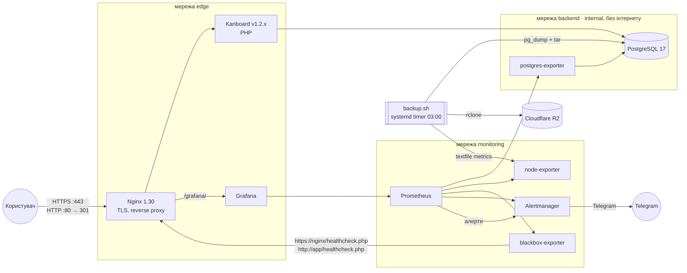

# UEEX — DevOps практичне завдання

Стек на Docker Compose на чистому Debian-хості:
**Kanboard (PHP) + PostgreSQL + Nginx (TLS)**, моніторинг **Prometheus + Alertmanager + Grafana**,
резервне копіювання з позахостовою копією в **Cloudflare R2**, оновлення та відкат застосунку,
автозапуск, ротація логів і runbook повного відновлення.

| Документ | Для чого |
|---|---|
| **[docs/RUNBOOK.md](docs/RUNBOOK.md)** | **Сервер впав: як підняти сервіс на новому хості з нуля** |
| [docs/OPERATIONS.md](docs/OPERATIONS.md) | Щоденна експлуатація: бекап/відновлення, оновлення/відкат, алерти, логи, сертифікат |
| [docs/DEMO.md](docs/DEMO.md) | Сценарій демонстрації кожного пункту завдання з очікуваним результатом |

---

## Архітектура



| Компонент | Образ | Доступ |
|---|---|---|
| Kanboard | `kanboard/kanboard:${APP_TAG}` | `https://<SERVER_NAME>/` |
| PostgreSQL | `postgres:17-alpine` | лише мережа `backend` |
| Nginx | `nginx:1.30-alpine` | `:80` (редирект), `:443` |
| Grafana | `grafana/grafana:13.2.5` | `https://<SERVER_NAME>/grafana/` |
| Prometheus | `prom/prometheus:v3.15.1` | `127.0.0.1:9090` (SSH-тунель) |
| Alertmanager | `prom/alertmanager:v0.34.2` | `127.0.0.1:9093` (SSH-тунель) |
| blackbox-exporter | `prom/blackbox-exporter:v0.29.1` | внутрішній |
| node-exporter | `prom/node-exporter:v1.12.1` | внутрішній |
| postgres-exporter | `quay.io/prometheuscommunity/postgres-exporter:v0.20.1` | внутрішній |

Усі версії зафіксовані — жодного `:latest`. На тестовому стенді публічно відкриті 80/443 (+22 для SSH);
як периметр виглядав би в продакшені — див. [Безпека](#безпека).

## Відповідність вимогам

| # | Вимога | Реалізація |
|---|---|---|
| 01 | Застосунок, PostgreSQL, Nginx + self-signed TLS | `compose.yaml`, `nginx/templates/default.conf.template`, `scripts/gen-cert.sh` (SAN = IP/DNS з `.env`) |
| 02 | Prometheus, Grafana, Alertmanager; алерт на недоступність застосунку/БД | `monitoring/`: алерти **`ApplicationDown`** (blackbox: повний шлях TLS→nginx→PHP→БД) і **`PostgresDown`** (`pg_up`), доставка в Telegram, inhibit-правило; дашборд «UEEX — огляд стека»; юніт-тести алертів `monitoring/prometheus/tests/` |
| 03 | Health-check, автозапуск після ребуту, ротація логів | `healthcheck` у кожного сервісу; `restart: unless-stopped` + systemd `ueex-stack.service`; ротація: `json-file` 10m×5 (у compose і `/etc/docker/daemon.json`) + ліміт journald |
| 04 | Скрипт бекапу БД за розкладом, демонстрація відновлення | `scripts/backup.sh` (pg_dump + перевірка + sha256 + R2 + ротація + метрики), `systemd/ueex-backup.timer` (щодня 03:00), `scripts/restore.sh`; алерт `BackupTooOld` |
| 05 | Оновлення образу без втрати даних з можливістю відкату | `scripts/update.sh` (pull → бекап → перемикання тегу → healthcheck → автовідкат), `scripts/rollback.sh [--restore-db]` |
| 06 | Git + runbook | цей репозиторій; [docs/RUNBOOK.md](docs/RUNBOOK.md); CI-перевірка `.github/workflows/validate.yml` |

## Структура репозиторію

```
.
├── compose.yaml                  # увесь стек
├── .env.example                  # шаблон конфігурації/секретів (.env не в Git)
├── nginx/templates/              # конфіг nginx (envsubst SERVER_NAME)
├── nginx/certs/                  # self-signed сертифікат (генерується, не в Git)
├── monitoring/
│   ├── prometheus/               # prometheus.yml, rules/alerts.yml, tests/alerts_test.yml
│   ├── alertmanager/             # alertmanager.yml генерується з .env
│   ├── blackbox/blackbox.yml
│   └── grafana/                  # provisioning (datasources, dashboards) + дашборд
├── scripts/
│   ├── bootstrap-host.sh         # підготовка чистого Debian: Docker, daemon.json, journald, swap, UFW
│   ├── install.sh                # розгортання стека + systemd-юніти
│   ├── backup.sh / restore.sh    # бекап і відновлення
│   ├── update.sh / rollback.sh   # оновлення і відкат застосунку
│   ├── gen-cert.sh, render-config.sh, lib.sh
│   └── validate.sh               # shellcheck + compose config + promtool (+ юніт-тести алертів); те саме в CI
├── systemd/                      # ueex-stack.service, ueex-backup.{service,timer}
├── host/                         # docker daemon.json, journald
└── docs/                         # RUNBOOK, OPERATIONS, DEMO
```

## Швидкий старт (чистий хост)

Повна інструкція з поясненнями та перевірками — у [docs/RUNBOOK.md](docs/RUNBOOK.md).

```bash
apt-get update && apt-get install -y git
git clone https://github.com/Deadflixer/ueex-devops-assignment.git /opt/ueex-stack && cd /opt/ueex-stack
./scripts/bootstrap-host.sh
cp .env.example .env && nano .env          # або .env з менеджера паролів
./scripts/install.sh
```

## Ключові рішення

- **Kanboard** — готовий PHP-застосунок з офіційними версіонованими образами і підтримкою
  PostgreSQL через `DATABASE_URL`; встановлення без веб-майстра, тож розгортання повністю відтворюване.
  Має `healthcheck.php`, який перевіряє і PHP, і зʼєднання з БД.
- **Конфігурація через `.env`**, єдине джерело секретів. У Git — лише шаблон. Файли з секретами
  (конфіг Alertmanager, ключ TLS) генеруються на хості скриптами.
- **Мережі розділені**: БД у `internal`-мережі без виходу в інтернет; Prometheus/Alertmanager
  слухають лише `127.0.0.1` (Docker обходить UFW, тому важливо не публікувати зайві порти).
- **Nginx резолвить upstream-и під час запиту** (`resolver 127.0.0.11`) — падіння Grafana чи app
  не заважає старту nginx; він віддає 502, а blackbox це фіксує.
- **Бекап = БД + файли Kanboard**, з перевіркою дампу (`pg_restore --list`), sha256, копією в R2
  і метриками для Prometheus. Бекап, який лежить лише на тому ж хості, не переживе втрату хоста.
- **Оновлення завжди починається з бекапу**: міграції схеми незворотні, тому відкат буває двох
  видів — лише образ (дані після оновлення зберігаються) або образ + БД з бекапу `pre-update`.
- **Автозапуск подвійний**: `restart: unless-stopped` піднімає контейнери разом з Docker,
  а `ueex-stack.service` гарантує `docker compose up -d` навіть після ручного `compose down`.

## Безпека

### Що зроблено на стенді

- Публічно відкриті лише 22/80/443 (UFW + публікація портів у compose лише для nginx).
- Секрети лише в `.env` (права 600) і на хості; у Git — шаблон. Паролі БД/Grafana генеруються `openssl rand`.
- БД у `internal`-мережі без доступу в інтернет; Prometheus/Alertmanager слухають лише `127.0.0.1`.
- `/healthcheck.php` через nginx доступний лише з внутрішніх мереж.
- Свідомо спрощено для тестового стенду: SSH-вхід під `root` з інтернету, сервіс напряму на IP.

### Як був би побудований периметр у продакшені

- **SSH — лише за ключем і лише з VPN.** Окремий користувач з sudo, `PasswordAuthentication no`,
  `PermitRootLogin no`; порт 22 відкритий тільки для підмережі VPN (WireGuard / корпоративний VPN),
  з інтернету недоступний. Додатково fail2ban.
- **80/443 — лише через Cloudflare proxy.** DNS-запис у режимі proxied; на хості вхідні 80/443
  дозволені тільки з IP-діапазонів Cloudflare (`https://www.cloudflare.com/ips-v4`, `/ips-v6`).
  Список оновлюється скриптом за systemd-таймером. Пряме звернення на IP сервера в обхід
  Cloudflare неможливе — сервіс отримує WAF, захист від DDoS і rate limiting.
  Важливо: Docker публікує порти в обхід UFW, тому whitelist задається в ланцюжку iptables
  `DOCKER-USER`, а не правилами UFW.
- **TLS — сертифікати Cloudflare.** Користувач бачить edge-сертифікат Cloudflare; між Cloudflare
  і nginx — Cloudflare Origin CA сертифікат, режим SSL «Full (strict)». Let's Encrypt не потрібен.
- Альтернатива без жодного відкритого вхідного порту — Cloudflare Tunnel (`cloudflared`):
  сервер сам встановлює вихідне зʼєднання до Cloudflare.

## Що б додав у продакшені

- Периметр вище: SSH за ключем через VPN, 80/443 лише з Cloudflare, сертифікати Cloudflare.
- Образи з власного registry з підписом/скануванням (Trivy), автоматизований деплой з CI.
- Бекап через WAL-архівацію (pgBackRest/WAL-G) для PITR і RPO у хвилини замість доби.
- Шифрування бекапів перед відправкою (age/gpg) і регулярне автоматичне тестове відновлення.
- Секрети в Vault / SOPS замість `.env`; провіжнінг хоста через Ansible/Terraform.
- Централізовані логи (Loki) і алерти на рівні хоста (CPU, RAM, OOM-kill).
